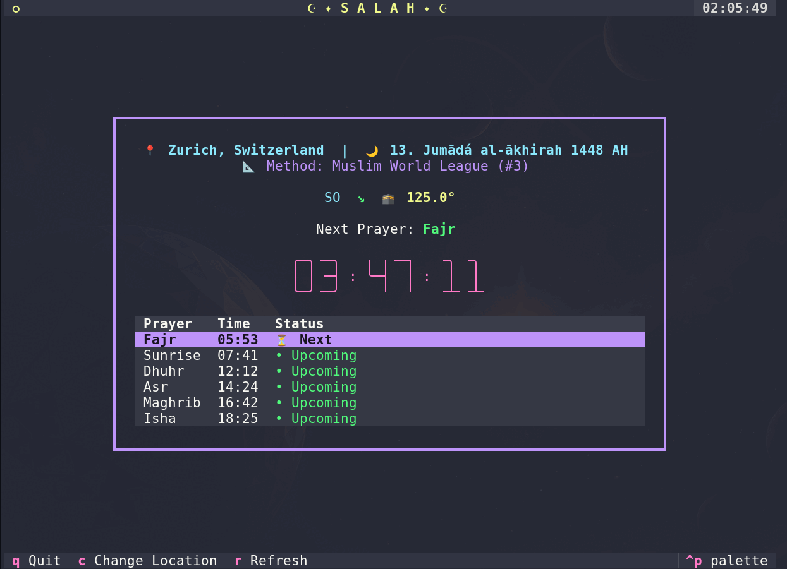

# ⚡ RAW INTERFACE

### 🧠 NO FILTERS. NO LECTURES. JUST RAW DATA.

- **The Message:** Communication is just noise until you decode the signal. 
- **The Reality:** Nothing is real. Everything is AI generated. Trust the code, not the pixels. 🤖
- **The Code:** Built on Linux, customized in Dracula dark mode. 🧛‍♂️

*“In a world of synthetics, clean syntax is the only truth left.”* 🚀

---

## ☪ Islamic Terminal Suite (Dracula Theme)

A minimalist suite of Islamic terminal applications built with Python & [Textual](https://textualize.io), styled in the [Dracula](https://draculatheme.com) dark theme.

  

| App | Command | Description | PyPI |
| :--- | :--- | :--- | :--- |
| **[salah-tui](https://github.com/postsonde/salah-tui.git)** | `salah` | Islamic prayer times with live countdown, Hijri date & calculation methods |  |
| **[hijri-tui](https://github.com/postsonde/hijri-tui.git)** | `hijri` | Native Hijri calendar with lunar phases, Sunnah fasting & holy days |  |
| **[quran-tui](https://github.com/postsonde/quran-tui.git)** | `quran` | Study the Holy Quran with 100+ translations, side-by-side view & bookmarks |  |
| **[asma-tui](https://github.com/postsonde/asma-tui.git)** | `asma` | Learn the 99 Names of Allah with flashcards, streak quiz & directory |  |
